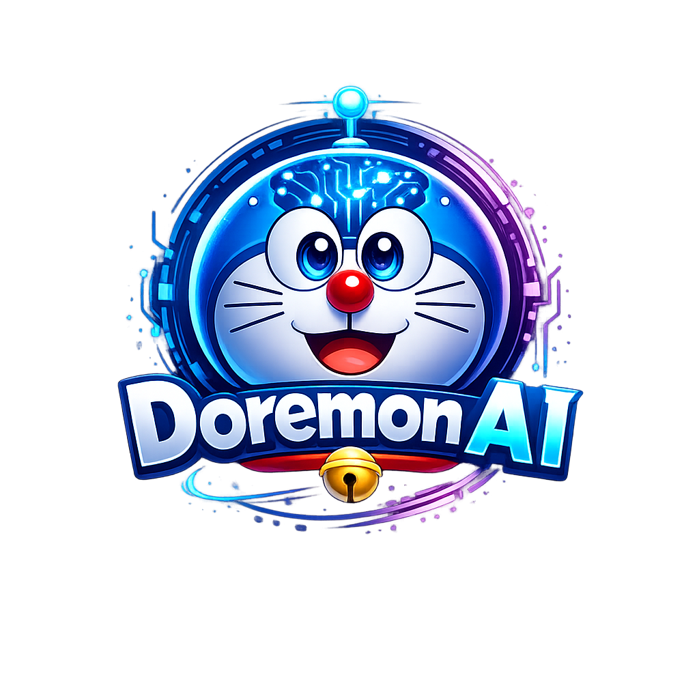

<div align="center">



# ✨ Doremon AI

### Your Personal AI Workspace — Smarter. Faster. All Yours.

*Chat · Agents · Research · Email · Notes · Calendar · Documents · Memory*

<br/>

[](https://python.org)
[](https://fastapi.tiangolo.com)
[](LICENSE)
[](https://github.com/nextgencode13/doremon-ai)

<br/>

[🚀 Quick Start](#-quick-start) · [💡 Features](#-features) · [🛠 Setup Guide](docs/setup.md) · [🗺 Roadmap](ROADMAP.md)

</div>

---

> ### ℹ️ Open-Source Persona Disclaimer
> The character names (Doraemon, Nobita, Shizuka, Gian, Suneo, Dekisugi, Dorami, Sensei, Jaiko)
> used in the persona presets are playful community homages for creative AI steering prompts.
> Doremon AI is an independent open-source project not affiliated with, endorsed by,
> or sponsored by Fujiko F. Fujio, Shin-Ei Animation, or Shogakukan.
> All original software code is licensed under [AGPL-3.0](LICENSE).

---

<div align="center">

## 🌟 Why Doremon AI?

*Stop paying for fragmented tools. Run everything in one place — on your machine, under your control.*

</div>

<br/>

<table>
<tr>
<td width="50%">

### 🔒 100% Private
Your data never leaves your machine. No subscriptions. No tracking. No cloud dependency.

</td>
<td width="50%">

### ⚡ Blazing Fast
Direct local model inference. Zero API latency. Works offline.

</td>
</tr>
<tr>
<td width="50%">

### 🧠 Actually Smart
Memory, RAG, agents, web research — all working together seamlessly.

</td>
<td width="50%">

### 🎨 Beautiful UI
Dark-themed, responsive, PWA-ready. Feels like a premium product.

</td>
</tr>
</table>

---

## 🚀 Quick Start

> Get up and running in under 5 minutes.

```powershell
git clone https://github.com/nextgencode13/doremon-ai.git
cd doremon-ai
Copy-Item .env.example .env
python -m pip install -r requirements.txt
python setup.py
python -m uvicorn app:app --host 127.0.0.1 --port 7000
```

Then open **http://localhost:7000** 🎉

> 🐳 Prefer Docker? One command runs everything:
> ```powershell
> docker compose up --build
> ```
> Full setup, GPU support, HTTPS — see the [Setup Guide](docs/setup.md).

---

## 💡 Features

<table>
<tr>
<td>💬</td>
<td><strong>Chat + Agents</strong></td>
<td>Local & API models, tools, MCP, file uploads, shell access, skills, and persistent memory</td>
</tr>
<tr>
<td>📚</td>
<td><strong>Cookbook</strong></td>
<td>Hardware-aware model recommendations, one-click downloads, and local serving</td>
</tr>
<tr>
<td>🔍</td>
<td><strong>Deep Research</strong></td>
<td>Multi-step web research with source reading, synthesis, and report generation</td>
</tr>
<tr>
<td>⚖️</td>
<td><strong>Compare</strong></td>
<td>Blind side-by-side model testing — pick the best without bias</td>
</tr>
<tr>
<td>📝</td>
<td><strong>Documents</strong></td>
<td>AI-powered editor with Markdown, HTML, CSV, syntax highlighting, and smart suggestions</td>
</tr>
<tr>
<td>📧</td>
<td><strong>Email</strong></td>
<td>IMAP/SMTP inbox with AI triage, tags, summaries, reminders, and reply drafts</td>
</tr>
<tr>
<td>📅</td>
<td><strong>Notes, Tasks & Calendar</strong></td>
<td>Todos, reminders, scheduled agent tasks, and CalDAV sync</td>
</tr>
<tr>
<td>🎨</td>
<td><strong>Gallery & Extras</strong></td>
<td>Image editor, themes, web search, presets, session history, and 2FA security</td>
</tr>
</table>

---

## 🖥️ Default Ports

| Service | URL |
|---|---|
| 🤖 Doremon AI | http://localhost:7000 |
| 🔎 SearXNG (Search) | http://localhost:8080 |
| 🗄️ ChromaDB (Vector DB) | http://localhost:8100 |
| 🔔 ntfy (Notifications) | http://localhost:8091 |

---

## 🔐 Security

Doremon AI is a self-hosted workspace with powerful local tools.

- ✅ Keep auth enabled
- ✅ Never commit `.env` to Git
- ✅ Do not expose model/service ports publicly

See the [setup guide](docs/setup.md#security-notes) for full details.

---

## 👨‍💻 Created By

<div align="center">

**Built with ❤️ by [Anubhav](https://github.com/anubhav-codes-13)**

<br/>

⭐ *If you like this project, give it a star!* ⭐

</div>

---

## 📄 License

AGPL-3.0-or-later — see [LICENSE](LICENSE) and [ACKNOWLEDGMENTS.md](ACKNOWLEDGMENTS.md).
